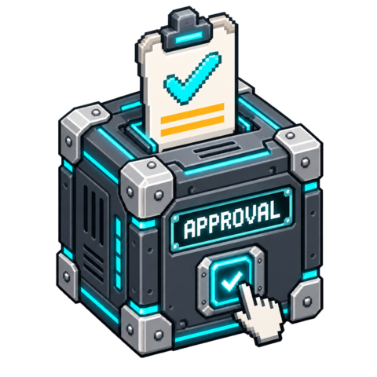

# Human Approval

> Development status: interactive delivery is currently blocked by the tested
> framework's UI-to-active-worker command transport. The full workflow tests are
> not passing; do not deploy or release this package yet. The interface below is
> the implemented target, not a claim of working interactive compatibility.

Review one precisely identified request, correct only explicitly allowed fields,
then approve or refuse its current revision. The browser submits a proposal; the
runtime listener validates it before any business output is published.

<!-- block-metadata:start -->
[](model.json)
[](compatibility.json)
[](LICENSE)

Compatibility evidence is pending. The development target is BloxSmith 1.0.9.
<!-- block-metadata:end -->

[](media/cover.png)

## Ports

| Direction | Port | Value |
| --- | --- | --- |
| Input | `request` | JSON with `id`, `case_id`, `revision`, `action`, `content`, optional `editable_fields` |
| Output | `approved` | Approved decision with corrected content, emitted once for that revision |
| Output | `decision` | Audit decision for either approve or reject; never treat this port as unconditional permission |

Wire side-effect blocks to **approved**. Wire **decision** to audit/state/display
consumers. Refusal, expiry, invalid requests and absent responses never emit on
`approved`. Run creates an idle listener; it does not approve anything.

```json
{
  "id": "send-summary-1",
  "case_id": "case-42",
  "revision": 0,
  "action": "Send the reviewed summary",
  "content": {"recipient": "internal", "comment": "Draft summary"},
  "editable_fields": ["comment"]
}
```

## Review and settings

Open the modal or inspector after starting Active Runtime. The preview shows the
full request content as text, never executable HTML. Edit the configured fields,
then choose **Approve this revision** or **Reject**. Form submission does not change
graph settings. Settings have their own Apply button and local drafts.

- `fields`: trusted editable schema, at most 20 top-level fields. Each declares
  `type` (`text`, `number`, `boolean`) and optional `required`. Text is capped at
  4,096 characters. Boolean false is a valid explicit value, even when required.
  Incoming `editable_fields` may narrow this schema but never expand it.
- `timeout_sec`: 10–86,400 seconds from receipt; expiry is checked in the listener
  even when the UI is closed.
- `max_requests`: remembered distinct request IDs for one Run, maximum 10,000.
  Full capacity refuses new IDs without evicting replay protection.
- `max_bytes`: bound on incoming JSON and corrected content, at most 64 KiB.

One pending request is retained. A new request/revision replaces it; there is no
unbounded queue. Exact replays are ignored. A changed payload under the same
ID/revision invalidates that review and requires a higher revision. Old browser
tokens, other-run submissions, duplicate clicks, expired reviews and readonly-field
edits cannot authorize the current request. Repeated requests need a higher revision.
This is a local review gate, not a verified multi-user signature: the output explicitly
reports `authenticated_identity: null`, because the available context does not supply
a trusted user identity. IDs/actions/content describe the request; the block never
performs the requested external action itself.

## Runtime semantics

**Active Runtime** owns the single-threaded state machine and emits graph results.
The UI uses the public `run_data_operations` action followed by `trigger_node`; execution
forwards the submission to the listener, which checks its token against the actual
pending request. There is one bounded nonpersistent `data.human_approval.<node-hash>.submission`
slot in the instance-scoped store, not a global queue or a graph setting. The slot
is visible to Data Map and uses the same generic store contract; no internal files
or framework-only services are accessed. Closing the modal does not cancel a pending review. Stop cancels
the wait without emitting approval. New Runs start fresh: replay protection is
run-local, not a durable compliance ledger. Connect decisions to Business State if
durable business correlation is needed.

**One Shot** validates and previews a request in runtime metadata but never approves
it automatically or waits for a browser. Interactive decisions require Active Runtime.
Invalid configuration or malformed incoming requests fail explicitly. Invalid user
edits remain recoverable without terminating the Run. Transport saturation remains
a visible framework diagnostic, not an implicit grant or silent retry.

After clicking, wait for runtime confirmation. A lost HTTP response can leave a
submission uncertain; resubmitting cannot duplicate an already approved revision.
Changing settings requires Stop/Run. The block stores no secrets and never persists
private review content in graph configuration.

## Development

English/French UI catalogs, release-owned ES modules and responsive styles are in
the package. Tests cover the state machine, expiry, stale clicks, readonly fields,
real runtime-state callbacks/listeners in bundled/managed/linked installations,
and browser layout, Apply/Cancel and draft persistence. No production instance or
external action is exercised by these tests.
